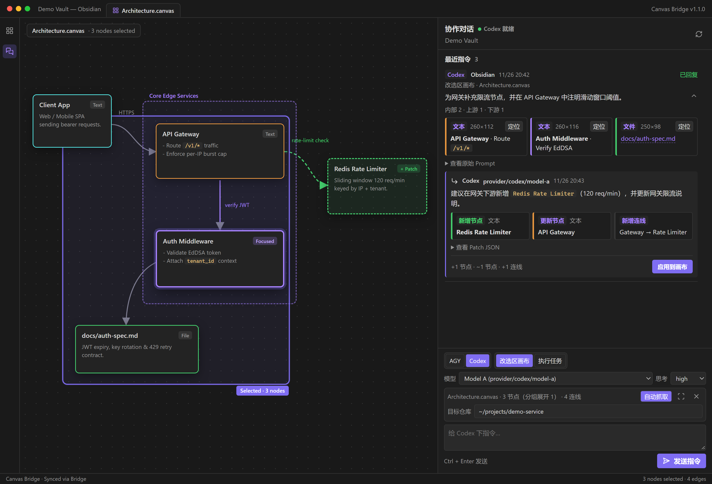
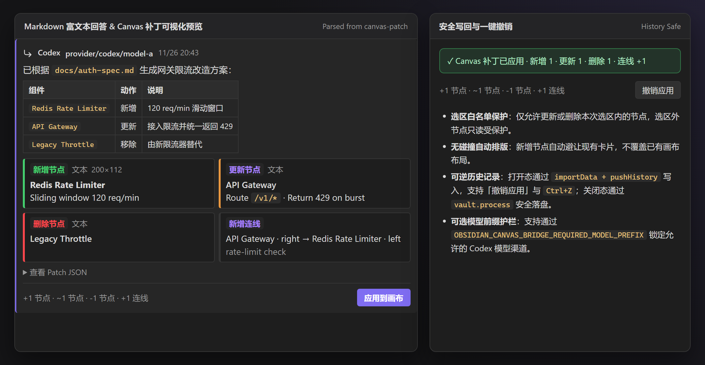

# Canvas Bridge (`obsidian-canvas-bridge`)

Obsidian desktop sidebar plugin that captures Canvas selections, linked note excerpts, and upstream/downstream edges, dispatches tasks to Antigravity or headless Codex via `Codex-Antigravity-Bridge`, renders rich Markdown replies and Canvas card previews, and applies/reverts `canvas-patch` edits directly in Obsidian.



## Features

- **Canvas Selection Auto-Capture & One-Click Locate**: Automatically tracks active Canvas selections (recursively expanding selected groups), resolves relative Markdown note excerpts, detects `repo:` paths, and lets you click **定位** on any card to select and zoom to the node without mutating the Canvas.


- **Native Markdown Replies, Visual Patch Cards & Safe Undo**: Renders replies with Obsidian's native `MarkdownRenderer`, turns `canvas-patch` blocks into color-coded node/edge diff cards, protects nodes outside the selection whitelist, avoids collisions for newly added cards, and applies/reverts edits via `importData + pushHistory` (or `vault.process` when closed).



- **Dual Executor & Model Picker**: Switch between Antigravity and Codex in the sidebar, dynamically pick models and reasoning efforts, and keep raw prompt/patch JSON collapsed unless needed.

## Prerequisites

- Obsidian Desktop `>= 1.13.0`
- Python 3.11+
- Installed `Codex-Antigravity-Bridge` desktop bridge

## Installation

Link this plugin directory into any Obsidian Vault as an NTFS Junction, then enable **Canvas Bridge** in Obsidian Settings -> Community Plugins:

```powershell
powershell -ExecutionPolicy Bypass -File .\link_vault.ps1 -VaultPath "<path-to-vault>"
```

## Running Tests

```powershell
node --test tests/canvas_context.test.js tests/main.test.js
python -m unittest discover -s tests -t . -p "test_*.py" -v
```

## Optional Model Prefix Guardrail

Set `OBSIDIAN_CANVAS_BRIDGE_REQUIRED_MODEL_PREFIX` to restrict Codex dispatch and model catalog entries to slugs starting with that prefix (e.g., `provider/`). When unset, any configured non-empty `worker_profile.model` is allowed.
