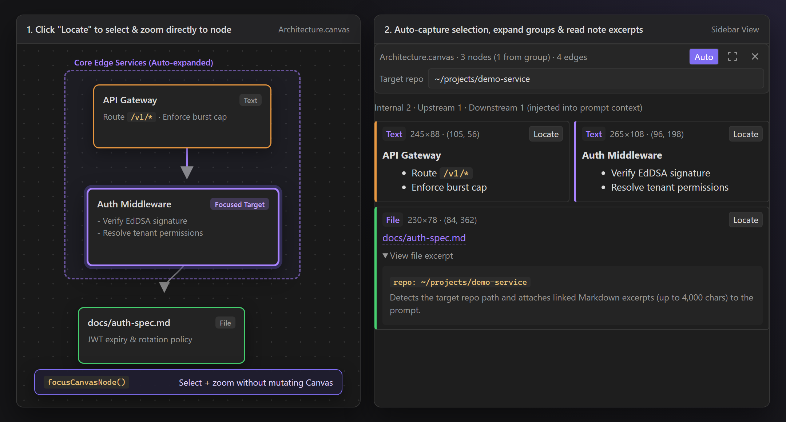

# Canvas Bridge (`obsidian-canvas-bridge`)

Canvas Bridge is an Obsidian desktop sidebar plugin that captures Canvas selections, linked note excerpts, and upstream/downstream edges. It sends tasks to OpenAI-compatible APIs, custom providers, or an optional Antigravity/Codex bridge, then renders Markdown replies and previews, applies, and reverts `canvas-patch` edits in Obsidian.


## Features

- **Canvas Selection Auto-Capture & One-Click Locate**: Automatically tracks active Canvas selections (recursively expanding selected groups), resolves relative Markdown note excerpts, detects `repo:` paths, and lets you click **定位** on any card to select and zoom to the node without mutating the Canvas.



- **Native Markdown Replies, Visual Patch Cards & Safe Undo**: Renders replies with Obsidian's native `MarkdownRenderer`, turns `canvas-patch` blocks into color-coded node/edge diff cards, protects nodes outside the selection whitelist, avoids collisions for newly added cards, and applies/reverts edits via `importData + pushHistory` (or `vault.process` when closed).


- **Provider & Model Picker**: Switch between enabled providers in the sidebar. Model, reasoning effort, and target repository controls follow the selected provider's capabilities.

## Prerequisites

- Obsidian Desktop `>= 1.13.0`

## Installation

Link this plugin directory into any Obsidian Vault as an NTFS Junction, then enable **Canvas Bridge** in Obsidian Settings -> Community Plugins:

```powershell
powershell -ExecutionPolicy Bypass -File .\link_vault.ps1 -VaultPath "<path-to-vault>"
```

## OpenAI-compatible APIs

The HTTP provider uses Obsidian's HTTP API and needs no extra packages or Python.

1. Open **Settings → Canvas Bridge**. Enable the **OpenAI API** profile or add another profile.
2. Set **Base URL** to the API root, for example `https://api.openai.com/v1`, or use a full `/chat/completions` URL. For a local compatible server such as Ollama, LM Studio, or vLLM, use the address exposed by that server and leave **API Key** blank if it accepts unauthenticated requests.
3. Enter model IDs separated by commas or newlines. Fill in the optional system prompt and click **测试连接** to check the corresponding `/models` endpoint.
4. Open the sidebar, choose the provider and model, and send an instruction. Capture a Canvas selection to include its nodes, edges, and linked note excerpts in the request. Review the generated patch before applying it.

The API key is saved in the plugin's gitignored `data.json`. The configured endpoint receives your instruction and any captured Canvas content included in the prompt. Recent HTTP tasks are saved locally per Vault.

## Optional Codex-Antigravity-Bridge

Install `Codex-Antigravity-Bridge` with Python 3.11+ and register `chatgpt-bridge` in Antigravity's MCP configuration. Enable the integration in **Settings → Canvas Bridge** and check the detection status. When detected, **AGY** and **Codex** appear in the sidebar with their existing pairing, model, and effort controls.

## Register a custom provider

From another plugin, call `registerProvider(adapter)` on the loaded Canvas Bridge plugin instance. Use a unique lowercase slug for `id`. `getStatus` and `listTasks` receive the Vault workspace path and may return a value or a promise. Return `{ ready: true }` when the provider can accept requests and `{ available: false }` to hide it. You can also report `models`, `defaultModel`, or `efforts` to populate the corresponding controls. `dispatch` receives the assembled `prompt` and metadata including `workspace`, `targetWorkspace`, `executor`, `mode`, `canvasPath`, `selectedIds`, `model`, and the idempotency `token`. Persist or deduplicate tokens in the adapter if it needs safe retries.

```js
const tasks = [];
canvasBridgePlugin.registerProvider({
  id: "review-assistant",
  label: "Review assistant",
  kind: "custom",
  capabilities: { modes: ["edit_canvas"], supportsEffort: false, supportsRepo: false },
  getStatus: () => ({ ready: true }),
  listTasks: workspace => tasks.filter(task => task.workspace === workspace),
  dispatch({ token, workspace, targetWorkspace, mode, canvasPath, selectedIds, prompt }) {
    const existing = tasks.find(task => task.workspace === workspace && task.id === token);
    if (existing) return { ok: true, id: existing.id };
    const task = {
      id: token, workspace, targetWorkspace, mode, canvasPath, selectedIds, prompt,
      status: "running", time: new Date().toISOString(),
    };
    tasks.push(task);
    const settled = Promise.resolve().then(() => yourModelClient.complete(prompt)).then(
      reply => Object.assign(task, { status: "replied", reply, replyTime: new Date().toISOString() }),
      error => Object.assign(task, { status: "blocked", error: String(error), replyTime: new Date().toISOString() }),
    );
    return { ok: true, id: token, settled };
  },
});
```

For background work, return `{ ok: true, id, settled }` with `settled` as a completion promise, or implement `subscribe(workspace, onChange)` to refresh the sidebar as task state changes. Return an unsubscribe function from `subscribe`. Call `unregisterProvider(id)` when your plugin unloads. `getProviders()` lists registered adapters, `providerLabel(id)` resolves their display names, and `updateSettings(nextSettings)` persists plugin settings.

## Running Tests

```powershell
node --test tests/canvas_context.test.js tests/providers.test.js tests/main.test.js
python -m unittest discover -s tests -t . -p "test_*.py" -v
```

## Optional Model Prefix Guardrail

Set `OBSIDIAN_CANVAS_BRIDGE_REQUIRED_MODEL_PREFIX` to restrict Codex dispatch and model catalog entries to slugs starting with that prefix (e.g., `provider/`). When unset, any configured non-empty `worker_profile.model` is allowed.
